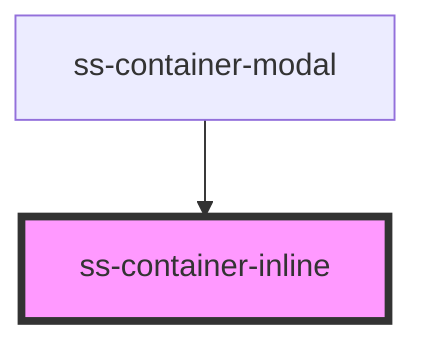

# ss-container-inline

<!-- Auto Generated Below -->

## Events

| Event       | Description                                                                                                                                                                                                                                                                                                                                                                                                                     | Type                                                               |
| ----------- | ------------------------------------------------------------------------------------------------------------------------------------------------------------------------------------------------------------------------------------------------------------------------------------------------------------------------------------------------------------------------------------------------------------------------------- | ------------------------------------------------------------------ |
| `authError` | Emitted when sign-in inside the frame cannot be established or kept, so the host can react (e.g. re-authenticate the user). reason is 'token-callback-failed' when getToken throws or times out, 'iframe-auth-failed' when Forms or DigiSign could not sign in inside the frame, 'token-renewal-failed' when a renewal failed twice, and 'signed-out' when the user signed out inside Forms or DigiSign during a token session. | `CustomEvent<{ reason: WidgetAuthErrorReason; error?: unknown; }>` |

## Dependencies

### Used by

 - [ss-container-modal](../ss-container-modal)

### Graph

----------------------------------------------

